# Sistem Pengelolaan Tagihan Air Perumahan Warga

**Nama:** Alya Aulia  
**NIM:** 2509116060  
**Kelas:** B  


---

## Deskripsi Singkat

Sistem Pengelolaan Tagihan Air Perumahan Warga merupakan aplikasi berbasis Java yang digunakan untuk membantu mengelola data warga, petugas, tagihan air, dan pembayaran secara terstruktur.

Program dibangun dengan menerapkan konsep Pemrograman Berorientasi Objek sehingga setiap data dan proses dikelompokkan ke dalam class sesuai dengan tanggung jawabnya. Program juga menggunakan pola MVC untuk memisahkan bagian tampilan, pengendalian alur program, dan pengelolaan data.

Untuk penyimpanan data, program terhubung dengan database MySQL menggunakan JDBC. Proses akses database dipisahkan menggunakan DAO dan menggunakan PreparedStatement untuk menjalankan perintah SQL secara terparameterisasi.

Selain JDBC, program juga menggunakan Hibernate ORM sebagai framework Object-Relational Mapping. Hibernate digunakan untuk memetakan object Java dengan tabel database sehingga data dapat diakses melalui object dan mekanisme query Hibernate.


---

## Struktur Package

Program dibagi menjadi beberapa package berdasarkan fungsi masing-masing agar kode lebih terorganisasi dan mudah dikembangkan.

```text
SistemTagihanAir
├── com.mycompany.sistemtagihanair
│   └── Main.java
│
├── config
│   ├── DatabaseConnection.java
│   └── TestDatabaseConnection.java
│
├── controller
│   └── MenuController.java
│
├── dao
│   ├── PembayaranDAO.java
│   ├── PetugasDAO.java
│   ├── TagihanAirDAO.java
│   └── WargaDAO.java
│
├── model
│   ├── DapatDihitung.java
│   ├── Pembayaran.java
│   ├── Petugas.java
│   ├── TagihanAir.java
│   ├── User.java
│   └── Warga.java
│
├── orm
│   ├── HibernateUtil.java
│   └── WargaORM.java
│
├── service
│   └── PengelolaanService.java
│
└── view
    └── MenuView.java
```

Konfigurasi Hibernate terdapat pada:

```text
src/main/resources/hibernate.properties
```

Dokumentasi gambar program disimpan pada folder:

```text
docs/
```


### Fungsi Setiap Package

**`model`**

Berisi class yang merepresentasikan objek dan data utama dalam sistem, seperti warga, petugas, tagihan air, dan pembayaran. Package ini juga berisi abstract class `User` dan interface `DapatDihitung`.


**`view`**

Digunakan untuk menangani tampilan dan interaksi dengan pengguna. `MenuView` menampilkan menu serta informasi yang diperlukan pengguna.


**`controller`**

Digunakan untuk mengatur alur berdasarkan pilihan pengguna. `MenuController` menerima input dari bagian View dan meneruskannya ke proses yang sesuai.


**`service`**

Berisi proses pengelolaan data dan menjadi penghubung antara Controller dengan DAO. Dengan adanya Service, logika proses tidak ditempatkan langsung pada bagian tampilan.


**`dao`**

DAO atau Data Access Object digunakan untuk menangani komunikasi antara program dengan database. Setiap DAO menangani data sesuai dengan objeknya, seperti `WargaDAO`, `PetugasDAO`, `TagihanAirDAO`, dan `PembayaranDAO`.


**`config`**

Berisi konfigurasi koneksi database. `DatabaseConnection` digunakan untuk membuat koneksi dari aplikasi Java menuju database MySQL.


**`orm`**

Berisi implementasi Hibernate ORM. `HibernateUtil` digunakan untuk menyiapkan konfigurasi dan `SessionFactory`, sedangkan `WargaORM` digunakan untuk mengakses data warga melalui Hibernate.


### Struktur Project

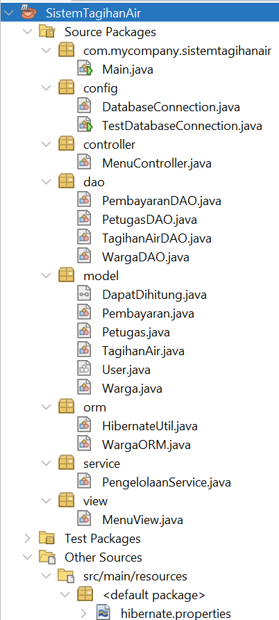


---

## Alur Program

Program dijalankan melalui `Main.java`. Setelah program dijalankan, pengguna berinteraksi dengan menu melalui bagian View.

Alur utama program adalah:

```text
Main
  ↓
View
  ↓
Controller
  ↓
Service
  ↓
DAO
  ↓
JDBC + PreparedStatement
  ↓
Database MySQL
```

`View` bertanggung jawab terhadap tampilan dan interaksi dengan pengguna.

`Controller` menerima pilihan pengguna dan menentukan proses yang akan dijalankan.

`Service` menangani proses pengelolaan data dan meneruskan kebutuhan akses data kepada DAO.

DAO kemudian melakukan komunikasi dengan database menggunakan JDBC dan PreparedStatement.

Data yang diperoleh dari database kemudian dikembalikan ke bagian program yang membutuhkan dan ditampilkan kepada pengguna.


### Tampilan Program

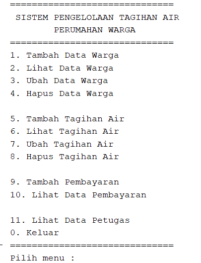


---

## Database

Program menggunakan database MySQL dengan nama:

```text
db_tagihan_air
```

Database digunakan sebagai tempat penyimpanan data yang dikelola oleh program.

Tabel utama yang digunakan adalah:

```text
warga
tagihan_air
pembayaran
petugas
```

Data awal disediakan melalui file SQL:

```text
database/db_tagihan_air.sql
```

File SQL tersebut digunakan untuk menyediakan struktur database sekaligus data awal. Dengan adanya data awal, program dapat langsung membaca data yang tersedia ketika proses pembacaan data dijalankan tanpa harus memasukkan seluruh data dari awal melalui program.

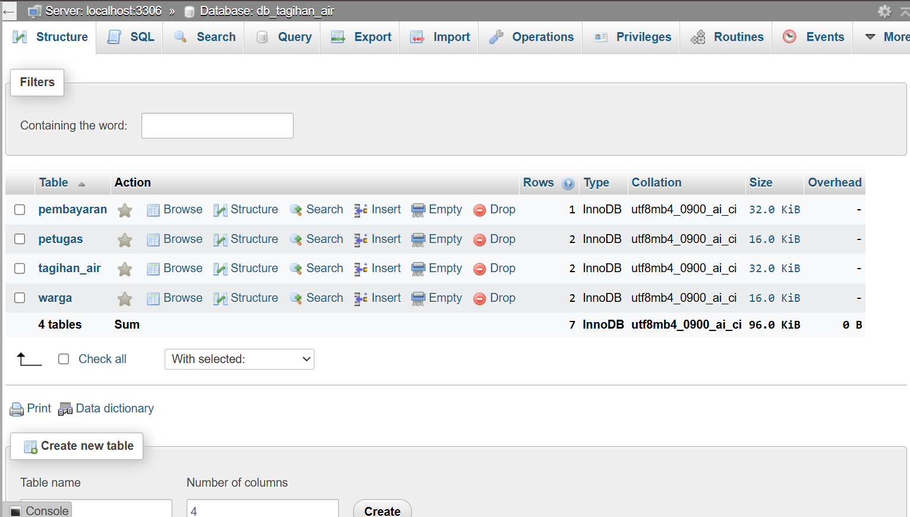


---

## Encapsulation

Encapsulation diterapkan dengan membatasi akses langsung terhadap atribut pada class menggunakan access modifier `private`.

Contohnya pada class `User`:

```java
private String idUser;
private String nama;
```

Atribut tersebut tidak diakses secara langsung dari luar class. Akses terhadap data dilakukan melalui method getter dan setter, seperti:

```java
getIdUser()
setIdUser()
getNama()
setNama()
```

Konsep ini membuat data di dalam object lebih terkontrol karena perubahan atau pengambilan nilai dilakukan melalui method yang disediakan oleh class.

Encapsulation juga diterapkan pada class lain yang memiliki atribut data seperti `Warga`, `TagihanAir`, dan `Pembayaran`.


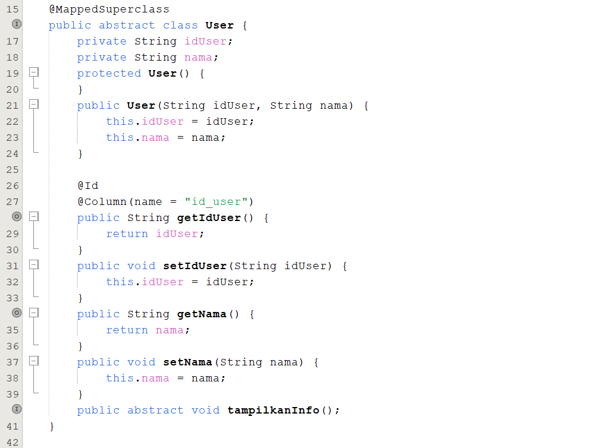


---

## Inheritance

Inheritance digunakan untuk membuat hubungan antara class induk dengan class turunannya.

Class `User` digunakan sebagai class induk, kemudian diturunkan menjadi `Warga` dan `Petugas`.

Strukturnya adalah:

```text
User
├── Warga
└── Petugas
```

Pada class `Warga` digunakan:

```java
public class Warga extends User
```

Sedangkan pada class `Petugas` digunakan:

```java
public class Petugas extends User
```

Dengan inheritance, class `Warga` dan `Petugas` dapat menggunakan atribut dan method yang berasal dari `User`, kemudian menambahkan atribut atau perilaku yang sesuai dengan karakteristik masing-masing.

Contohnya, `Warga` memiliki informasi alamat dan nomor rumah, sedangkan `Petugas` memiliki informasi jabatan.


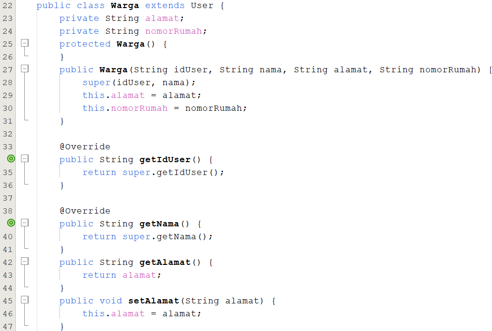


---

## Polymorphism

Polymorphism diterapkan melalui **overriding** dan **overloading**.


### Overriding

Overriding terjadi ketika class turunan atau class implementasi memberikan implementasi terhadap method yang berasal dari class induk atau interface.

Salah satu penandanya adalah penggunaan:

```java
@Override
```

Pada class turunan, method dapat memiliki perilaku yang disesuaikan dengan jenis object yang digunakan.

Contohnya method `tampilkanInfo()` pada `User` didefinisikan sebagai abstract method, kemudian implementasinya diberikan oleh class turunannya.


### Overloading

Overloading diterapkan pada class `TagihanAir` melalui method `hitungTotal()`.

Terdapat method dengan nama yang sama tetapi memiliki parameter yang berbeda:

```java
public int hitungTotal()
```

dan:

```java
public int hitungTotal(int pemakaian)
```

Perbedaan parameter memungkinkan method dengan nama yang sama digunakan dalam kondisi yang berbeda.

Method tanpa parameter menggunakan data pemakaian yang terdapat pada object, sedangkan method dengan parameter dapat menerima nilai pemakaian tertentu untuk proses perhitungan.


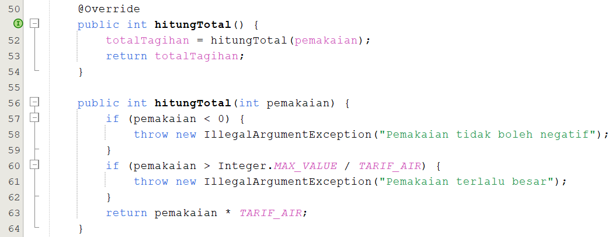


---

## Abstraction

Abstraction diterapkan menggunakan abstract class dan abstract method.

Class `User` dibuat sebagai abstract class:

```java
public abstract class User
```

Class tersebut juga memiliki abstract method:

```java
public abstract void tampilkanInfo();
```

Abstract class digunakan untuk menyediakan struktur umum yang dapat diwariskan oleh class turunannya tanpa harus membuat object `User` secara langsung.

Abstract method `tampilkanInfo()` tidak memiliki implementasi pada `User`. Implementasinya diberikan oleh class yang mewarisinya sesuai dengan karakteristik masing-masing object.

Dengan demikian, class `User` menyediakan aturan umum, sedangkan detail implementasinya ditentukan oleh class turunan.


---

## Interface

Program menggunakan interface `DapatDihitung`.

Interface tersebut mendefinisikan method:

```java
public interface DapatDihitung {
    int hitungTotal();
}
```

Interface kemudian diterapkan oleh class `TagihanAir`:

```java
public class TagihanAir implements DapatDihitung
```

Class `TagihanAir` memberikan implementasi terhadap method `hitungTotal()` yang telah ditentukan oleh interface.

Interface digunakan untuk mendefinisikan kemampuan atau kontrak yang harus dimiliki oleh class yang mengimplementasikannya.


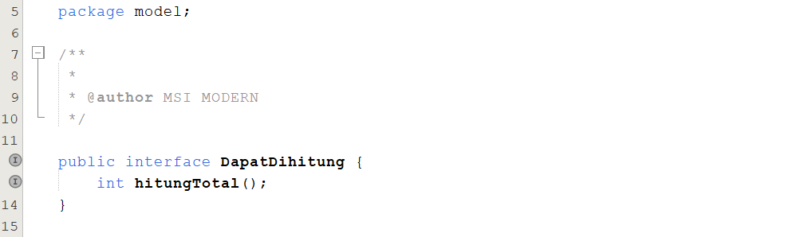


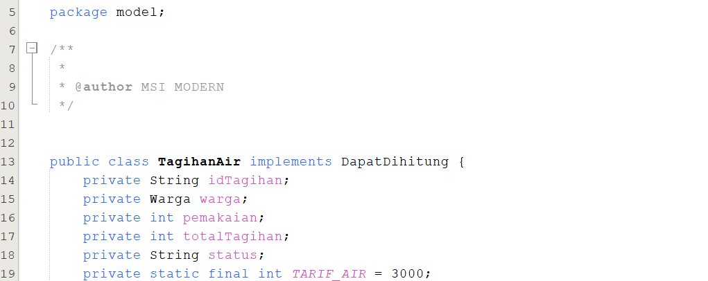


---

## JDBC

JDBC atau Java Database Connectivity digunakan sebagai penghubung antara aplikasi Java dengan database.

Dalam program ini, JDBC digunakan agar aplikasi dapat:

- Membuka koneksi ke database MySQL.
- Menjalankan perintah SQL.
- Mengirim parameter ke query.
- Mengambil data dari database.
- Menyimpan, mengubah, atau menghapus data sesuai proses yang dijalankan.

Koneksi database dipusatkan pada class:

```text
config/DatabaseConnection.java
```

Koneksi dibuat menggunakan `DriverManager`:

```java
DriverManager.getConnection(URL, USER, PASSWORD);
```

Dengan adanya class khusus untuk koneksi, proses pembuatan koneksi tidak perlu ditulis berulang kali pada setiap bagian program.


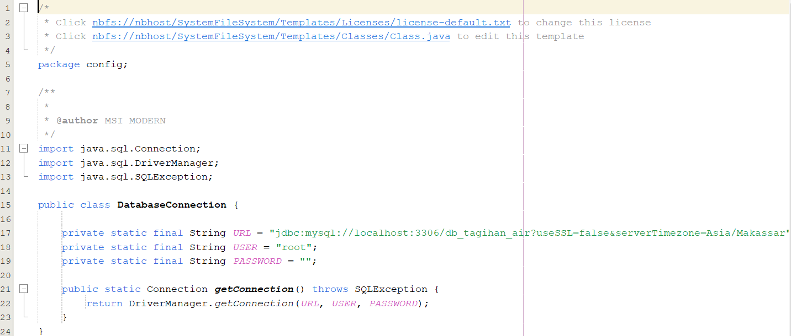


---

## PreparedStatement

PreparedStatement digunakan dalam proses pengiriman perintah SQL yang membutuhkan parameter.

Contohnya:

```java
PreparedStatement statement = connection.prepareStatement(sql);
```

Parameter query kemudian diberikan menggunakan method yang sesuai dengan tipe datanya, misalnya:

```java
statement.setString(...);
```

Setelah parameter diberikan, perintah dapat dijalankan menggunakan method seperti:

```java
statement.executeUpdate();
```

PreparedStatement membantu membuat query lebih terstruktur karena nilai yang diberikan pengguna dipisahkan dari struktur perintah SQL.

PreparedStatement digunakan pada bagian DAO ketika program melakukan operasi terhadap database.


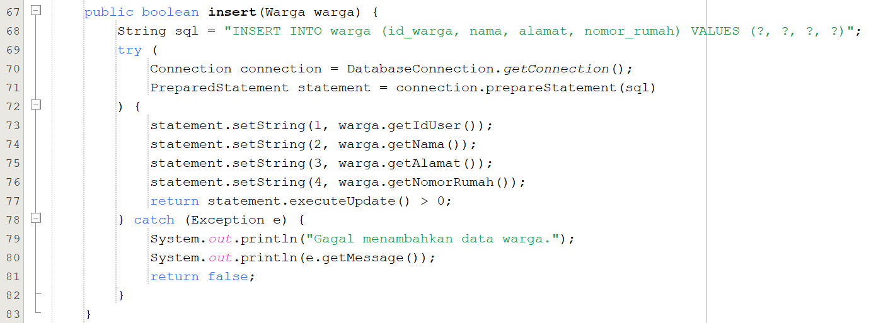


---

## DAO

DAO atau **Data Access Object** digunakan untuk memisahkan proses akses database dari bagian program lainnya.

DAO bertanggung jawab menangani proses yang berhubungan langsung dengan penyimpanan dan pengambilan data.

DAO yang digunakan dalam program adalah:

```text
WargaDAO
PetugasDAO
TagihanAirDAO
PembayaranDAO
```

Pemisahan menggunakan DAO membuat struktur program lebih terorganisasi karena Controller dan Service tidak perlu menangani detail SQL secara langsung.

Sebagai contoh, kebutuhan pengelolaan data warga ditangani oleh `WargaDAO`, sedangkan kebutuhan data tagihan ditangani oleh `TagihanAirDAO`.

Dengan pendekatan tersebut, setiap bagian program memiliki tanggung jawab yang lebih jelas.


---

## MVC

Program menggunakan struktur MVC yang terdiri dari Model, View, dan Controller.

```text
Model
  ↕
Controller
  ↕
View
```

### Model

Model berisi representasi data dan objek yang digunakan dalam sistem. Pada program ini, model berada pada package `model`.


### View

View bertanggung jawab menampilkan informasi dan menerima interaksi dari pengguna. Implementasinya terdapat pada package `view`.


### Controller

Controller mengatur alur interaksi antara View dengan proses pengelolaan data. Implementasinya terdapat pada package `controller`.

Struktur MVC membantu memisahkan tanggung jawab setiap bagian sehingga program lebih mudah dipahami dan dikembangkan.


---

## Hibernate ORM

Hibernate ORM digunakan sebagai framework **Object-Relational Mapping (ORM)**.

ORM digunakan untuk memetakan object pada program Java dengan tabel pada database relasional.

Dalam program ini, Hibernate menjadi penerapan tambahan untuk mengakses data menggunakan pendekatan object-relational mapping.

Implementasi Hibernate terdapat pada package:

```text
orm
├── HibernateUtil.java
└── WargaORM.java
```

Konfigurasi Hibernate terdapat pada:

```text
src/main/resources/hibernate.properties
```


### HibernateUtil

`HibernateUtil` digunakan untuk menyiapkan konfigurasi Hibernate dan membangun `SessionFactory`.

Entity `Warga` didaftarkan melalui:

```java
.addAnnotatedClass(Warga.class)
.buildSessionFactory();
```

`SessionFactory` kemudian digunakan untuk membuat session yang dapat digunakan untuk berinteraksi dengan database.


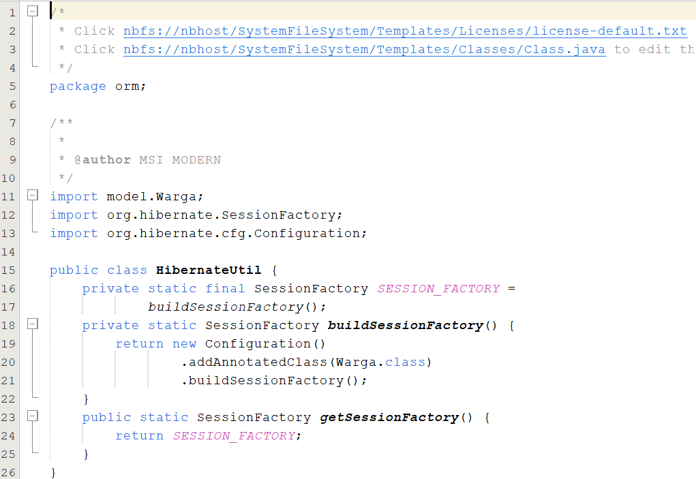


### WargaORM

`WargaORM` digunakan untuk mengambil data `Warga` menggunakan Hibernate.

Data diambil menggunakan query:

```java
createSelectionQuery("from Warga", Warga.class)
```

Kemudian hasil query diperoleh menggunakan:

```java
getResultList()
```

Query tersebut menggunakan nama entity `Warga`, sehingga proses pengambilan data dilakukan melalui object dan mekanisme Hibernate.


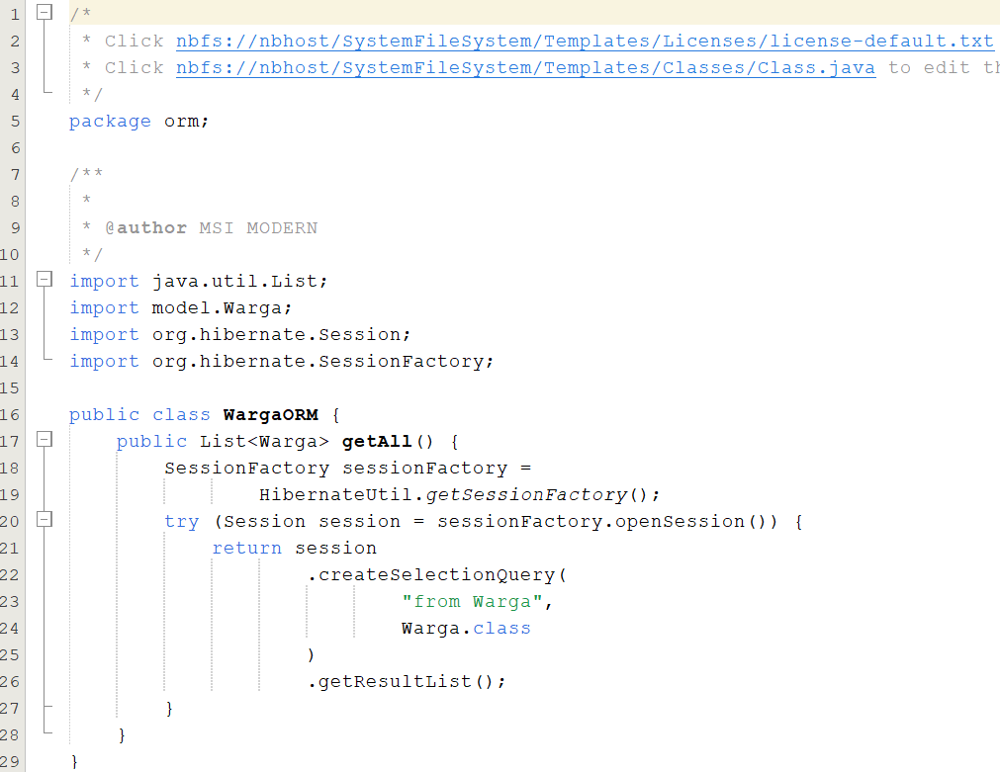


### Entity

Class `Warga` dipetakan sebagai entity menggunakan:

```java
@Entity
@Table(name = "warga")
```

Pemetaan atribut ke kolom database juga menggunakan anotasi seperti:

```java
@Column
```

dan:

```java
@AttributeOverride
```

Dengan mapping tersebut, Hibernate mengetahui hubungan antara object `Warga` dengan tabel `warga` pada database.


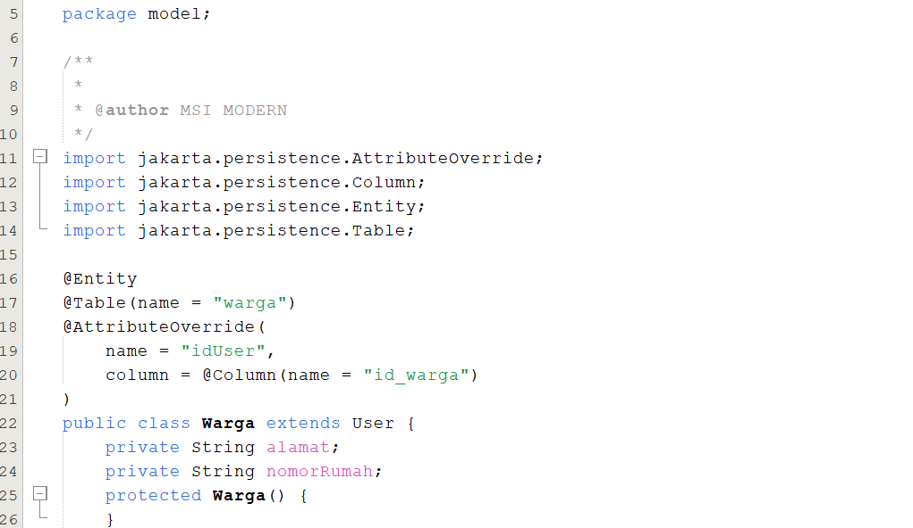


---

## Nilai Tambah

Nilai tambah pada program terdapat pada penggunaan **Hibernate ORM** sebagai framework Object-Relational Mapping.

Hibernate digunakan untuk menunjukkan pendekatan lain dalam mengakses database selain JDBC.

Implementasinya terdapat pada:

```text
orm
├── HibernateUtil.java
└── WargaORM.java
```

Konfigurasi ORM terdapat pada:

```text
src/main/resources/hibernate.properties
```

Hibernate melakukan pemetaan antara class `Warga` dengan tabel `warga` dan memungkinkan data diambil menggunakan query Hibernate.

Implementasi ORM telah berhasil digunakan untuk membaca data warga dari database.


---

